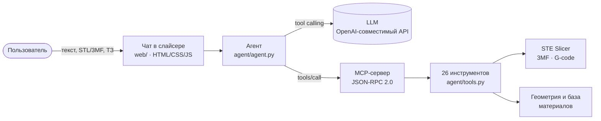

# AI Assistant для STE Slicer


Плагин для слайсера **STE Slicer 7.10** (Stereotech, форк Cura 3.6). В слайсер встраивается чат с ИИ-агентом: вы описываете задачу печати текстом, прикладываете модель или техническое задание, а агент подбирает режим, материал и настройки, ориентирует модель, режет её и объясняет каждое решение.

Команда **HandBloodы**. Проект сделан для кейса Stereotech на хакатоне «Открой.Моспром».

---

## Как это работает



Агент не полагается на память модели. Цифры берутся из кода: анализ геометрии, база материалов с инженерными свойствами и проверка каждого значения по допустимым диапазонам слайсера.

## Что умеет

- **Режимы печати:** 3D (`classic`), 5D Spiral (`cylindrical`) и 5D (`cylindrical_full`).
- **Материалы:** подбор по требованиям из ТЗ, например температура, химия, водопоглощение.
- **Геометрия:** определяет тело вращения, ось и осевое отверстие, считает нависания, предлагает ориентацию.
- **Нарезка:** запускает слайсинг, показывает прогресс, сохраняет проект `.3mf` и G-code и проверяет G-code.
- **Объяснения:** таблица «параметр → значение → почему» со ссылкой на пункт ТЗ.
- **Вложения:** STL, OBJ, 3MF, JPG, PNG, DOCX.

## Инструменты агента

Все 26 инструментов доступны и агенту, и внешнему MCP-клиенту.

| Группа | Кол-во | Примеры |
|---|:---:|---|
| Сцена | 1 | `get_scene_info` |
| Профили | 3 | `list_profiles`, `set_profile`, `create_profile` |
| Материалы | 5 | `recommend_materials`, `set_material`, `material_properties` |
| Настройки | 4 | `get_settings`, `find_settings`, `set_settings`, `reset_settings` |
| Режим печати | 1 | `set_print_mode` |
| Модели | 7 | `load_model`, `analyze_model`, `orient_model`, `arrange_all` |
| Слайсинг | 5 | `slice`, `slice_status`, `export_gcode`, `save_project`, `validate_gcode` |

## Прогресс

| Часть | Статус |
|---|---|
| Каркас плагина (`plugin.json`, `api: 5`) | ✅ |
| Чат-интерфейс (история, вложения, карточки вызовов) | ✅ |
| MCP-сервер (`initialize`, `tools/list`, `tools/call`) | ✅ |
| Анализ геометрии и база материалов | ✅ |
| Клиент LLM с проверкой сертификатов | ✅ |
| Сквозной сценарий «чат → агент → G-code» на одной модели | 🚧 |
| Режимы 5D (нужна лицензия ATSS) | 🚧 |
| Проверка всех тестовых моделей против эталонных 3MF | 🚧 |

## Установка и настройка

Подробная инструкция с путями и проверкой лежит в [plugin/README.md](plugin/README.md). Коротко:

1. Установите STE Slicer 7.10. Для режимов 5D активируйте лицензию ATSS.
2. Скопируйте папку `plugin/AIAssistant` в папку плагинов слайсера.
3. Перезапустите слайсер и откройте пункт **AI Assistant** в меню.
4. В настройках LLM укажите URL OpenAI-совместимого API, ключ и модель.

Ключ хранится в настройках слайсера и в код не попадает.

## Структура

```
plugin/
├── README.md              установка и настройка
└── AIAssistant/
    ├── AIAssistant.py     точка входа плагина
    ├── dock.py            боковая панель чата
    ├── plugin.json        манифест (api 5)
    ├── web/               интерфейс чата: HTML, CSS, JS
    └── agent/
        ├── agent.py       цикл диалога с моделью
        ├── llm_client.py  клиент OpenAI-совместимого API
        ├── mcp_server.py  MCP-сервер (JSON-RPC 2.0)
        ├── tools.py       реестр 26 инструментов
        ├── slicer_api.py  вызовы функций слайсера
        ├── geometry.py    анализ геометрии модели
        ├── knowledge.py   материалы и правила печати
        ├── main_thread.py выполнение в главном потоке Qt
        ├── events.py      события для интерфейса чата
        └── certs/         дополнительные корневые сертификаты
```

## Технические требования

- **Python 3.5** из дистрибутива STE Slicer. Внешние библиотеки не используются.
- **PyQt5**, numpy и certifi уже входят в дистрибутив.
- Изменения сцены и настроек выполняются в главном потоке Qt через `app.callLater`.

## Команда

**HandBloodы**: участники команды ведут разработку в этом репозитории. Ветка `main` защищена: изменения попадают в неё через pull request, force push запрещён.
