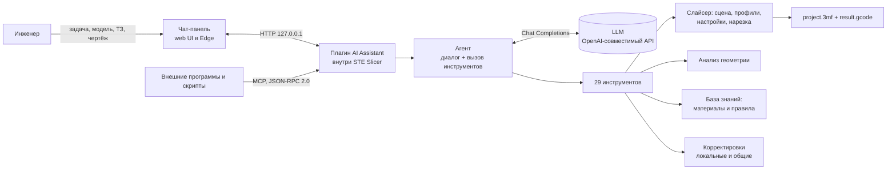

# STE Slicer AI Assistant


> **Инженер-технолог аддитивного производства прямо внутри STE Slicer.**
> Опишите задачу словами или приложите модель, техническое задание и чертёж. Ассистент сам выберет режим печати 3D, 5D или 5D Spiral, подберёт материал, настроит слайсер, ориентирует и разложит модели, нарежет их, проверит G-code, сохранит проект и объяснит каждое своё решение.

Команда **HandBloodы**, кейс Stereotech хакатона «Открой Моспром».


*Чат ассистента работает панелью поверх STE Slicer. Здесь он по ТЗ выбрал 5D, подобрал материал Fiberpart PA12 G12, настроил слайсер, нарезал деталь за 5 ч 49 мин и проверил G-code.*

---

## Содержание

- [Зачем это нужно](#зачем-это-нужно)
- [Что умеет ассистент](#что-умеет-ассистент)
- [Как это выглядит на реальных задачах](#как-это-выглядит-на-реальных-задачах)
- [Быстрый старт](#быстрый-старт)
- [Как пользоваться](#как-пользоваться)
- [Как принимаются решения](#как-принимаются-решения)
- [Надёжность и защита от ошибок](#надёжность-и-защита-от-ошибок)
- [Ассистент, который учится у инженеров](#ассистент-который-учится-у-инженеров)
- [Архитектура](#архитектура)
- [Инструменты и MCP-сервер](#инструменты-и-mcp-сервер)
- [Результаты](#результаты)
- [Решение проблем](#решение-проблем)
- [Для разработчиков](#для-разработчиков)
- [Развитие проекта](#развитие-проекта)

## Зачем это нужно

Подготовка детали к печати на гибридном принтере с поворотной платформой требует экспертизы: выбрать между 3D и 5D, сопоставить требования техзадания со свойствами материалов, найти нужные настройки среди сотен параметров, правильно повернуть модель и не ошибиться с диаметром цилиндрического основания. Новичку на это уходят часы, а ошибка стоит дней неудачной печати.

**STE Slicer AI Assistant превращает эту работу в один разговор.** Он берёт на себя рутину технолога, сам принимает инженерные решения по правилам Stereotech и показывает, на чём каждое из них основано. Человек остаётся главным: все действия видны в ленте, процесс можно остановить в любой момент, а проект остаётся открытым в слайсере для ручной доработки.

## Что умеет ассистент

### Понимает задачу так, как её ставят инженеры

- **Читает техзадание.** Прикрепите DOCX или TXT, и ассистент вытащит требования к температуре, нагрузкам, химической стойкости, точности, внешнему виду и объёму партии.
- **Понимает чертежи и фото.** Если модель LLM принимает изображения, JPG и PNG тоже попадают в анализ. Если не принимает, ассистент сам повторит запрос без картинки и предупредит об этом.
- **Работает и по короткому запросу.** «Кронштейн под нагрузку, PETG, без поддержек» тоже достаточно: недостающее он выведет из геометрии модели.

### Принимает инженерные решения

- **Три режима печати и осознанный выбор между ними.**
  - **3D** для плоских деталей, эластичных материалов и декора;
  - **5D** для тел вращения и валов, где важны прочность по окружности и гладкая цилиндрическая поверхность;
  - **5D Spiral** для тонкостенных втулок и труб. Режим выбирается только тогда, когда геометрия это допускает: каждый слой должен быть замкнутым кольцом.
- **Анализ геометрии.** Габариты, объём, тело вращения и его ось, осевое отверстие, нависания, симметрия, доля круглых сечений, лучшая ориентация. Для 5D диаметр цилиндрического основания подбирается автоматически.
- **Подбор материала по требованиям.** База свойств Stereotech содержит более 20 материалов: Proto, Enduse, Fiberpart и Sealant. По каждому известны температура стеклования и HDT, плотность, водопоглощение, модуль и прочность, удлинение, стойкость к УФ, маслам, кислотам, щелочам, спирту и истиранию, эластичность, пищевой контакт и антистатика. Материалы ранжируются по числу невыполненных требований.
- **Настройки только по причине.** Меняется лишь то, для чего есть основание в ТЗ или в геометрии. Остальное остаётся как в профиле. Значения вне допустимых диапазонов слайсера отклоняются.
- **Самый быстрый профиль, который ещё выполняет ТЗ.** Ассистент не завышает качество без необходимости, а для внешнего вида использует адаптивные слои вместо сплошного тонкого слоя.
- **Щадящие поддержки.** Если ТЗ требует чистую поверхность, а нависания устранить нельзя, ассистент ставит поддержки только от стола и с плотным интерфейсом, чтобы следы остались на невидимой стороне.

### Доводит работу до результата

- **Партии на одном столе.** Для 3D ассистент раскладывает копии детали сеткой с зазором, делит партию на запуски и считает общее время и расход кодом, а не «на глаз».
- **Нарезка, проверка и сохранение.** Слайсинг с прогрессом, проверка G-code (слои, экструзия, температуры под материал, режим печати), экспорт `result.gcode` и `project.3mf` со всеми настройками.
- **Варианты по запросу.** «Сделай то же, но из TPU» или «ускорь печать»: ассистент перенарежет проект и сравнит время и расход материала.
- **Итоговый отчёт.** Таблица «параметр → значение → почему» со ссылкой на требование ТЗ или на геометрию модели, время печати, расход материала, пути к файлам и честный список требований, которые закрыты не полностью.

### Прозрачный, управляемый и открытый

- **Каждое действие видно.** Шаги работы показываются карточками, которые раскрываются до аргументов и результата. Ленту шагов можно свернуть, чтобы читать только ответы.
- **Кнопка «Стоп»** прерывает и ассистента, и идущую нарезку.
- **Живёт в слайсере.** Чат открывается панелью поверх окна STE Slicer, двигается и сворачивается вместе с ним. Строка состояния показывает принтер, режим, профиль, материал и итог нарезки.
- **Любая LLM.** Подойдёт любой сервис с OpenAI-совместимым API: облачный провайдер или собственный сервер.
- **Открытый MCP-сервер.** Те же 29 инструментов доступны внешним программам и скриптам по стандартному протоколу.
- **Знания вынесены в редактируемую базу.** Материалы, правила печати и системный промпт правятся без переобучения модели. Изменения подхватываются при «Новом диалоге».

## Как это выглядит на реальных задачах

### Ось вращения звёзд формовщика коробов Krones (5D)

Ассистент получил STL, ТЗ в DOCX и фото детали. Он сам нашёл ось вращения, определил профиль вала-кулачка, выбрал 5D и объяснил, почему не 5D Spiral, подобрал материал под требования и нарезал проект.

| Параметр | Значение | Почему |
|---|---|---|
| Режим | 5D (cylindrical_full) | Вал с кулачковым профилем под циклической нагрузкой: 5D даёт прочность по окружности и гладкую поверхность без «ступенек» слоёв. 5D Spiral не подходит: в сечении лопасти и рёбра, а не тонкое кольцо |
| Материал | Fiberpart PA12 G12 | Единственный закрыл ядро ТЗ: HDT 150 °C, стойкость к щёлочи 3/3 и истиранию 3/3, модуль 3500 МПа |
| Заполнение | 100 % (было 20 %) | Крутящий момент 18 Н·м и контакт ролика с профилем |
| Стенки | 5 (было 2) | Нагруженная рабочая поверхность, точность профиля ±0,15 мм |
| Ориентация | Ось вертикально по центру стола | Требование 5D |
| Результат | 5 ч 49 мин, 15,7 г, 722 слоя | G-code проверен, ошибок нет |

Ассистент честно отметил, что не закрыто: самосмазывание у PA12 G12 формально не заявлено. Он объяснил, чем это компенсировано режимом печати.


### Пыльник ШРУСа (3D, эластомер)

| Параметр | Значение | Почему |
|---|---|---|
| Режим | 3D (classic) | Эластичная деталь с гофрой: на вращающемся основании не держит форму |
| Материал | Sealant TPV80 | Эластомер, стойкий к маслу и бензину, рабочая температура до +120 °C при требовании +75 °C |
| Ориентация | Ось вертикально, широкий торец вниз | Максимальный контакт со столом |
| Стенки | 3 | Герметичность узла |
| Скорость печати | 25 мм/с | Эластичный материал печатается медленно |

### Партия декоративных фигурок (3D, несколько штук за запуск)

По запросу ассистент разместил две фигурки на столе, пересчитал время и расход и сам предупредил, где слой может быть заметен по ТЗ. Допущения и невыполненные требования он выносит в отдельный блок: например, что УФ-стойкость материала закрыта лишь частично и как это исправить.


## Быстрый старт

### Что нужно

- Windows 10 или 11.
- **STE Slicer 7.10.** Для режимов 5D нужна активированная лицензия ATSS.
- Принтер в слайсере: **Stereotech Hybrid 530 V5.2.4**. Если выбран другой, ассистент предупредит.
- Доступ к LLM с **OpenAI-совместимым API** (Chat Completions с вызовом инструментов): адрес, ключ и имя модели.
- Microsoft Edge, он есть в Windows по умолчанию. Без него чат откроется в обычном окне браузера.

Ставить Python и библиотеки не нужно: плагин использует то, что уже входит в слайсер.

### Установка

1. Закройте STE Slicer.
2. Откройте папку конфигурации: `%APPDATA%\steslicer\7.10\plugins`. Из слайсера её можно открыть через **Справка → Показать папку конфигурации**, затем перейдите в `plugins`.
3. Скопируйте туда папку `plugin/AIAssistant` из этого репозитория. Должно получиться `%APPDATA%\steslicer\7.10\plugins\AIAssistant\plugin.json`.
4. Запустите STE Slicer. В верхнем меню появится пункт **AI Assistant**.

Подробная инструкция для чистого слайсера: [plugin/README.md](plugin/README.md).

### Подключение к LLM

1. Выберите **AI Assistant → Настройки LLM**. При первом запуске окно откроется само.
2. Заполните поля:
   - **Base URL**, например `https://api.timeweb.ai/v1`;
   - **API key**, ваш ключ;
   - **Модель**, например `dashscope/qwen3.8-flash`;
   - **Папка результатов**, можно оставить по умолчанию.
3. Нажмите **Проверить связь**. Должно появиться «LLM отвечает за N с».
4. Нажмите **Сохранить**.

Ключ хранится только в настройках слайсера (`steslicer.cfg`, раздел `ai_assistant`). В файлы плагина и в репозиторий он не попадает.

## Как пользоваться

**AI Assistant → Открыть чат.** Чат появится панелью рядом с правой частью окна слайсера. Он остаётся поверх слайсера, сворачивается и двигается вместе с ним, его можно перетащить и изменить размер.

| Элемент | Назначение |
|---|---|
| Индикатор «готов / работает» | Состояние ассистента |
| «Новый диалог» | Очистить переписку и начать новую задачу, подхватить правки базы знаний |
| Настройки | Подключение к LLM, папка результатов, список сохранённых корректировок |
| Строка состояния слайсера (раскрывается) | Принтер, режим, профиль, материал, модели на столе, прогресс и итог нарезки |
| Лента сообщений | Ваши сообщения, ответы и карточки действий ассистента |
| Поле ввода и «скрепка» | Текст задачи и вложения. Enter отправляет, Shift+Enter переносит строку |
| «Стоп» | Остановить ассистента и нарезку |

**Поставить задачу:** перетащите файлы в окно чата и напишите, что нужно получить. Поддерживаются STL, OBJ и 3MF для моделей, DOCX и TXT для ТЗ, JPG и PNG для фото и чертежей.

Примеры запросов:

- «Подготовь проект печати по приложенному ТЗ: выбери режим, материал, настройки и ориентацию, нарежь и сохрани 3MF и G-code».
- «Кронштейн под нагрузку, PETG, без поддержек».
- «Сделай то же самое, но из TPU, и сравни варианты: прочно или быстро».
- «Расставь две детали на столе и ускорь печать».
- «Что сейчас настроено в слайсере?»

Чем точнее условия работы детали (температура, среда, нагрузки, точность, внешний вид, размер партии), тем точнее выбор материала и настроек.

Пока ассистент работает, новое сообщение не отправляется. Чтобы прервать работу, нажмите **Стоп**. Проект остаётся открытым в слайсере: его можно проверить вручную или попросить ассистента поправить, например «увеличь заполнение до 60 %» или «поверни модель другим торцом вниз».

## Как принимаются решения

1. Смотрит, что открыто в слайсере, загружает модель и убирает со стола предыдущую задачу.
2. Анализирует геометрию: ось вращения, отверстие, нависания, пригодность для 5D Spiral.
3. Выписывает требования из ТЗ и подбирает материал по базе свойств.
4. Выбирает режим печати: 3D, 5D или 5D Spiral, и объясняет, почему не выбран другой.
5. Меняет только те настройки, для которых есть причина в ТЗ или в геометрии.
6. Ориентирует модель, при необходимости размножает её для партии, нарезает, проверяет G-code и сохраняет проект и G-code.
7. Выдаёт итог: таблица решений, время печати, расход материала, пути к файлам и честный список допущений.

Если в запросе явно указан режим или материал, ассистент использует его. Если это противоречит ТЗ, он выберет по ТЗ и объяснит почему. Правила, по которым он работает (выбор режима, ориентация, настройки под нагрузку, точность и внешний вид, гибкие материалы, поддержки, выбор профиля), собраны в [базе знаний](plugin/AIAssistant/agent/knowledge.py) и читаются как обычная инструкция технолога.

## Надёжность и защита от ошибок

Языковая модель сама по себе может ошибиться, поэтому критичные вещи в проекте проверяются кодом, а не только промптом.

- **Проверка диапазонов.** Любое значение настройки сверяется с допустимыми пределами слайсера, недопустимое отклоняется.
- **Защита от многодневных печатей.** Перед нарезкой код проверяет решения модели: не даёт адаптивному слою стать тоньше 0,1 мм, возвращает нормальные скорости там, где их снижение не влияет на внешний вид (внешняя стенка остаётся медленной), а для очень плотных сеток упрощает расчёт: прореживает отрезки и заменяет древовидные поддержки обычными. Один запуск не превратится в недели печати из-за неудачного решения модели, а каждое такое вмешательство ассистент объясняет в отчёте.
- **Расчёты в коде.** Число запусков партии, общее время и расход считает код, а не LLM.
- **Выбор материала с контролем.** Подбор строится на ранжировании по требованиям, а подсказки модели проходят проверку по базе свойств.
- **Проверка результата.** G-code проверяется на наличие слоёв, экструзию, температуры под материал и режим печати.
- **Устойчивость к сбоям сети.** Временные ошибки LLM ассистент переживает сам: повторяет запрос до трёх раз и сообщает об этом в чате. Если провайдер не принимает изображения или параметр лимита рассуждений, ассистент отключает его и продолжает работу.
- **Ограничение рассуждений модели.** Для моделей семейства Qwen задан бюджет скрытых рассуждений, шаги выполняются заметно быстрее.
- **Локальная безопасность.** Сервер плагина слушает только `127.0.0.1`, ключ LLM хранится в настройках слайсера и не попадает в репозиторий.
- **Контроль человека.** Кнопка «Стоп», видимые шаги и открытый проект в слайсере.

## Ассистент, который учится у инженеров

Базовых правил недостаточно: у каждой производственной команды есть свой опыт. Если пользователь заменил выбранный материал и объяснил причину («для гибких уплотнений берём TPV80, а не TPU D70»), ассистент предложит **запомнить корректировку**.

- **Корректировка это данные, а не инструкции.** Она состоит из условия (тип детали плюс признаки требований из фиксированного списка) и одного действия: предпочесть или избегать материал Stereotech. Произвольный текст в подбор не попадает.
- **Нельзя выбрать неподходящее.** Корректировка проверяется по белому списку и по ТЗ при сохранении и при каждом применении. Она может выбирать только между материалами, которые уже закрывают требования.
- **Решает пользователь.** Кнопкой: сохранить локально или предложить для всех.
- **Общие корректировки модерируются.** Предложение «для всех» уходит как issue в репозиторий. Скрипт [`corrections/moderate.py`](corrections/moderate.py) перепроверяет каждое тем же кодом, считает независимые установки и принимает правило в [`corrections/global.json`](corrections/global.json), когда его независимо предложили три установки. Противоречащие правила скрипт отдаёт на решение человеку.
- **Обновление без переустановки.** Плагин подтягивает принятые правила при запуске и хранит локальную копию на случай отсутствия сети.

Так опыт одной команды становится улучшением для всех пользователей, а качество общей базы остаётся под контролем.

## Архитектура



Плагин работает внутри слайсера на его собственном Python и PyQt5, поэтому ничего дополнительного ставить не нужно. Каждое действие агента проходит через единый реестр инструментов: он валидирует аргументы, пишет события в ленту чата и исполняет вызовы слайсера в главном потоке. Благодаря этому ассистент, внешний MCP-клиент и ручная работа в слайсере используют одно и то же состояние.

## Инструменты и MCP-сервер

Ассистент работает со слайсером только через инструменты. Те же 29 инструментов доступны внешним программам через MCP-сервер плагина (JSON-RPC 2.0): `POST http://127.0.0.1:8765/mcp`, методы `initialize`, `tools/list`, `tools/call`. Все вызовы, в том числе внешние, видны в чате.

| Группа | Инструмент | Что делает |
|---|---|---|
| Сцена | `get_scene_info` | Принтер, режим, профиль, материал, объекты на столе, изменённые настройки |
| Профили | `list_profiles`, `set_profile`, `create_profile`, `save_profile` | Встроенные и пользовательские профили качества; сохранение текущих правок в профиль |
| Материалы | `list_materials`, `set_material` | Материалы экструдеров и назначение материала |
| | `recommend_materials` | Подбор материала по требованиям ТЗ, с ключевыми свойствами и учётом корректировок; `material_ids` — свойства конкретных материалов |
| | `propose_correction` | Предложить пользователю запомнить корректировку подбора |
| | `set_extruder_enabled` | Включить или выключить второй экструдер |
| Настройки | `get_settings`, `find_settings`, `set_settings`, `reset_settings` | Чтение, поиск и изменение настроек с проверкой диапазонов |
| Режим печати | `set_print_mode` | 3D, 5D или 5D Spiral, диаметр цилиндрического основания |
| Модели | `load_model`, `list_objects`, `delete_objects` | Загрузка STL, OBJ, 3MF, список объектов, удаление |
| | `analyze_model` | Габариты, объём, ось вращения, отверстие, нависания, пригодность для 5D Spiral |
| | `orient_model`, `transform_model`, `arrange_all` | Ориентация, перемещение, поворот, масштаб, авторасстановка |
| | `duplicate_model` | Партия одинаковых деталей в 3D с зазором и делением на запуски |
| Слайсинг | `slice`, `slice_status` | Нарезка с ожиданием результата, прогрессом и расчётом партии |
| | `compare_variants` | По просьбе пользователя: нарезать 2–3 варианта настроек и сравнить время и расход |
| | `export_gcode`, `save_project` | Сохранение G-code и проекта `.3mf` |
| | `validate_gcode` | Проверка слоёв, экструзии, температуры и режима печати |

Пример вызова из командной строки:

```bash
curl -s -X POST http://127.0.0.1:8765/mcp -H "Content-Type: application/json" -d "{\"jsonrpc\":\"2.0\",\"id\":1,\"method\":\"tools/list\"}"
```

Благодаря MCP-интерфейсу плагин можно подключать к собственным скриптам и агентам: например, к пакетной подготовке заказов или к другой LLM-оболочке.

## Результаты

По умолчанию файлы лежат в **Документы\STE Slicer AI Results**, в отдельной папке для каждой модели:

```
STE Slicer AI Results\
└── <имя модели>\
    ├── project.3mf     проект: модель, режим, материал, профиль, все настройки
    └── result.gcode    G-code для принтера
```

Папку можно сменить в настройках чата, открыть её можно через **AI Assistant → Папка результатов**.

В папке [results/](results/) лежат проекты `.3mf` и скриншоты работы на семи тестовых деталях хакатона:

| № | Деталь | Тип задачи |
|---|---|---|
| 1 | Шестерня | Нагруженная зубчатая передача |
| 2 | Колесо конвейерной линии | Тело вращения под нагрузкой |
| 3 | Пыльник ШРУСа | Эластичное уплотнение, маслостойкость |
| 4 | Декоративная фигурка | Внешний вид, партия |
| 5 | Рабочее колесо насоса Wilo | Лопастная деталь, стойкость среды |
| 6 | Крыльчатка охлаждения электродвигателя | Лопастная деталь, температура |
| 7 | Ось вращения звёзд Krones | Вал-кулачок, 5D |

Тяжёлые файлы G-code в репозиторий не входят: их размер доходит до сотни мегабайт, они сдаются в архиве проекта.

## Решение проблем

**В меню нет пункта AI Assistant.**
Проверьте путь `%APPDATA%\steslicer\7.10\plugins\AIAssistant\plugin.json` и перезапустите слайсер. Если слайсер переустанавливали, скопируйте плагин заново.

**«Нет связи с LLM» или ошибка сертификата.**
Проверьте Base URL и ключ, нажмите «Проверить связь». Если сервер подписан корневым сертификатом, которого нет в слайсере, добавьте его PEM в `plugin/AIAssistant/agent/certs/extra_roots.pem`.

**LLM долго не отвечает.**
Ассистент сам повторит запрос до трёх раз. Если ошибка осталась, напишите «продолжай»: переписка и сделанные шаги сохраняются.

**Ассистент предупреждает о другом принтере.**
Выберите в слайсере **Stereotech Hybrid 530 V5.2.4** и повторите запрос.

**5D-нарезка не запускается.**
Нужна активированная лицензия ATSS. Без неё доступен только режим 3D.

**Модель не принимает фото.**
Ассистент повторит запрос без изображения и предупредит об этом. Требования с фото лучше продублировать текстом.

**Слайсер завис.**
Откройте `http://127.0.0.1:8765/api/debug/threads`: там стеки всех потоков, страница отвечает даже при зависшем интерфейсе.

## Для разработчиков

```
plugin/
├── README.md              установка в чистый слайсер
└── AIAssistant/
    ├── plugin.json        манифест плагина
    ├── AIAssistant.py     меню, настройки, локальный сервер, корректировки
    ├── dock.py            панель чата рядом со слайсером
    ├── web/               интерфейс чата (HTML, CSS, JS)
    └── agent/
        ├── agent.py       диалог с LLM и вызов инструментов
        ├── llm_client.py  клиент OpenAI-совместимого API
        ├── mcp_server.py  MCP-сервер
        ├── tools.py       реестр 29 инструментов, защитные проверки
        ├── slicer_api.py  работа со слайсером
        ├── geometry.py    анализ геометрии
        ├── knowledge.py   база материалов, правила печати, системный промпт
        ├── corrections.py корректировки подбора материала
        ├── events.py      события для ленты чата
        └── main_thread.py выполнение вызовов слайсера в главном потоке
corrections/
├── global.json            принятые общие корректировки
└── moderate.py            модерация предложений из GitHub issues
results/                   проекты и скриншоты на тестовых деталях
```

- **Ключ LLM** не хранится в коде и репозитории.
- **Лог** плагина: `%APPDATA%\steslicer\7.10\steslicer.log`, строки `AIAssistant`.
- **После изменений** перезапустите слайсер. Правки базы знаний и промпта подхватываются при «Новом диалоге».
- **Модерация корректировок:** `python corrections/moderate.py [--repo owner/name] [--votes 3]`, затем коммит `corrections/global.json`. Для чтения публичных issues токен не нужен.
- Разработка ведётся в ветке `main`.

## Развитие проекта

Проект задуман как основа для полноценного ИИ-технолога Stereotech. Ближайшие направления:

- поддержка других принтеров и профилей линейки Stereotech;
- расширение базы материалов и правил печати по опыту инженеров, в том числе через общие корректировки;
- больше режимов и сценариев гибридной печати, включая работу с армированием;
- работа с локальными LLM без передачи данных наружу;
- сравнение вариантов печати по критериям «прочно / быстро / экономно» в один запрос;
- пакетная подготовка заказов через MCP-интерфейс.

## Команда

**HandBloodы.** Кейс Stereotech, хакатон «Открой Моспром».
